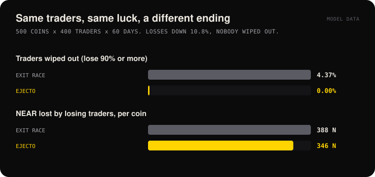
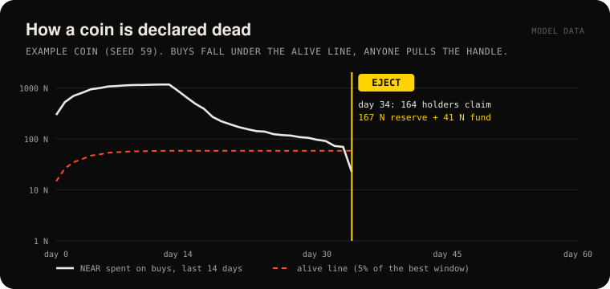
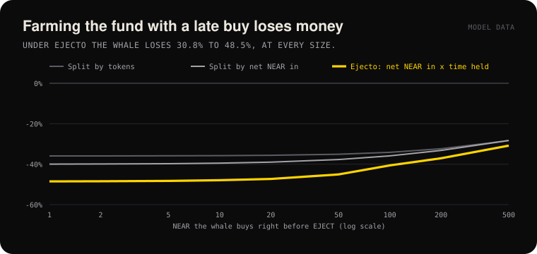

# Ejecto

[](https://github.com/wngstnr-code/ejecto/actions/workflows/ci.yml) [](https://github.com/wngstnr-code/ejecto/actions/workflows/chain.yml)   

**Every memecoin needs an ejecto seato.**

> **TL;DR.** Memecoins die, and when they do the holders race for the exit and the last ones out lose everything. On Ejecto the meme does something about it: every coin carries a fund that its trades fill, a death rule written in its keyless contract, and an ejection seat anyone can pull. When the coin dies, the whole crew exits together at one fair split and the fund pays the most loyal. If the crew still believes, it can call a **Mayday** and buy the coin back to life together, and nobody loses a cent if the rescue fails. In the model, the race losers go from **24.8% wiped out to 0%**. [Judge it in 60 seconds](#judge-it-in-60-seconds), or check everything without a wallet with `node scripts/verify-chain.mjs`.

Ejecto is a memecoin launchpad on NEAR where every coin has an ejection seat. Each coin trades on a bonding curve inside its own keyless contract, and a small part of every trade goes into the **Ejecto Fund**. When the coin dies, anyone can press **EJECT**: trading stops forever and every holder claims a fair share of the reserve plus a loyalty share of the fund. No exit race, no total wipeout, no admin.

| | |
|---|---|
| Live app (NEAR testnet) | https://ejecto.vercel.app |
| Demo video | https://x.com/Dudung_gg/status/2120481271784824863 |
| Factory contract (source verified, frozen, keyless) | [`fleet.ejecto.testnet`](https://testnet.nearblocks.io/address/fleet.ejecto.testnet/contract/code) |
| A coin rescued by its crew (one failed Mayday, one rescue) | [`phoenix.fleet.ejecto.testnet`](https://ejecto.vercel.app/coin/?id=phoenix.fleet.ejecto.testnet) |
| Mechanism note, every claim mapped to its test | [`docs/mechanism.md`](docs/mechanism.md) |
| Track | Memecoins With Mechanics |
| Judge it in 60 seconds | Seven Jury Seats, one per judge, are parked ready to EJECT: [buy, eject, claim, or call a Mayday](#judge-it-in-60-seconds) with your own testnet wallet |

Built at NEAR HACKATHON 2026.

---

## The problem

About two thirds of memecoins stop trading within a day. When a coin dies, holders race to sell into a falling curve: the fastest sellers get something, the last ones get almost nothing. The most loyal holders lose the most, and the fees they paid never come back to them.

## The mechanic

All of it lives in the coin contract (`contracts/coin`). There is no backend.

1. **Bonding curve.** Price is `P0 + K x supply` (`P0` = 2e-8 NEAR, `K` = 5e-16 NEAR per token). Buys mint from the curve, sells burn into it. The reserve always equals the area under the curve. Supply starts at 0: no premine, no creator allocation.
2. **Ejecto Fund.** Every buy and sell pays a fund fee (preset chosen at launch: light 0.5% / 1%, standard 1.5% / 2%, high 3% / 5%). A 0.5% protocol fee is taken on buys.
3. **Alive detector.** The contract tracks buy volume per day. The *alive line* is 5% of the best 14-day window ever, at least 1 NEAR. Once the coin is 14 days old and the last 14 days of buys fall under the line, the coin is dead.
4. **EJECT.** Anyone can call `eject()` on a dead coin. Trading stops forever and the reserve, the fund and every holder's weight are frozen in a snapshot.
5. **Claim.** Each holder calls `claim()` and receives:
   - a **reserve share**, pro-rata to their token balance (nobody races to the exit), plus
   - a **fund share**, weighted by **net NEAR at risk multiplied by time held** (loyalty, not size, is rewarded; transfers move basis, not weight).
6. **Mayday.** A dying coin does not have to end. Anyone can call a Mayday instead of EJECT: for 3 days the crew pledges NEAR toward a target (1x to 3x the alive line). If the target is reached, all pledges buy in together at **one price** and the coin is alive again. If not, **every pledge comes back in full**. The fund spends nothing; a pledge is capital at risk, so it earns loyalty weight for the time it was locked, exactly like holding.
7. **Keyless and fixed.** The factory creates each coin as `<symbol>.fleet.ejecto.testnet` with **no access keys** and the contract has **no owner methods**. Every parameter is locked at launch, and the factory itself is frozen and has no key, so nobody can change the code of future coins either.

Late buyers can still lose some money: early buyers got more tokens per NEAR, so the pro-rata split favors them. What Ejecto removes is the exit race and total wipeouts, and it pays loyalty. The people it protects most are the ones who would lose the race: in the model, 24.8% of the last quarter of holders to sell are wiped out in an exit race, and none with Ejecto ([Simulation](#simulation)).

## Why NEAR (concretely)

Ejecto leans on things NEAR has at the protocol level. Each row says what it is used for and how to check it yourself.

| NEAR feature | What Ejecto uses it for | Check it |
|---|---|---|
| **An account per contract, keys per account** | Every coin is its own named account, `<symbol>.fleet.ejecto.testnet`, created with **no access key**. With no key, nobody can sign for the account, so nobody can redeploy, upgrade or drain it: "no rug" is a property of the account, not a promise. | `near account list-keys jury1.fleet.ejecto.testnet network-config testnet now` shows an empty table |
| **Atomic batch actions** | The factory launches a coin in one batch: create the account, fund it, deploy the code, call `new`. If any step fails the whole batch reverts, so a half-made coin with a key can never exist. | [`create_coin`](https://github.com/wngstnr-code/ejecto/blob/31bfad3/contracts/factory/src/lib.rs#L148) and the sandbox test `launch_is_keyless_and_full_lifecycle_works` |
| **Frozen factory, then no key** | The factory stores the one verified coin code. `freeze()` made `set_coin_code` fail forever and the factory account's own key was deleted, so the code of *future* coins cannot change either. | `get_config` on `fleet.ejecto.testnet` shows the code hash and `"frozen": true`; `list-keys` shows no key |
| **Storage staking** | A coin pays for its own state out of the launch deposit (code size times the storage price plus 0.3 NEAR, 2.95 NEAR today), and each holder's entry is paid by NEP-145 `storage_deposit`. Nothing has rent that can run out and nobody has to keep a server paid. | `verify-chain` checks that every coin's balance covers reserve, fund, protocol fees, held pledges **and** storage |
| **Cheap, predictable gas** | Every method is O(1): no loop over holders or pledgers. A Mayday rescue with any number of pledgers costs 4.2 Tgas (about 0.0004 NEAR); EJECT costs 1.9 Tgas. That is what makes "anyone can pull the handle" and a crowd rescue practical. | Gas printed by the sandbox tests (`cargo test --test integration -- --nocapture`) |
| **Promise-based transfers** | Payouts (sell, claim, refunds of pledges) are plain transfers sent after the state is final, so a failed or delayed transfer can never leave the books half-updated. | `sell`, `claim`, `withdraw_pledge` in [`lib.rs`](https://github.com/wngstnr-code/ejecto/blob/31bfad3/contracts/coin/src/lib.rs) |
| **NEP-141 / NEP-145 / NEP-297 / NEP-330** | Standard token and storage, standard events for every buy, sell, Mayday step, EJECT and claim, and the build metadata that ties the deployed wasm to a git commit. | `ft_metadata`, the on-chain log on any coin page, `contract_source_metadata` |
| **Reproducible builds and SourceScan** | Both contracts are built in a pinned image and verified on NearBlocks, so the code you read on GitHub is the code that runs. | **Contract Source Code Verified** on the [factory](https://testnet.nearblocks.io/address/fleet.ejecto.testnet/contract/code) and every coin |

There is no backend: the web app is a static site that reads contract views over public RPC, signs with NEAR Connect, and rebuilds the price history and the log in the browser from the contracts' own events.

---

## For judges

The fastest way to see the mechanic is [Judge it in 60 seconds](#judge-it-in-60-seconds): seven coins are parked ready to EJECT, so you can buy, eject and claim (or rescue) with your own wallet. Every claim below is mapped to the test that proves it in [`docs/mechanism.md`](docs/mechanism.md). The fastest way to check the claims below without a wallet is `node scripts/verify-chain.mjs`.

| Criterion | Where it is answered |
|---|---|
| Technical implementation | All of the mechanic is in the coin contract: bonding curve [`curve.rs`](https://github.com/wngstnr-code/ejecto/blob/31bfad3/contracts/coin/src/curve.rs), loyalty weights (net NEAR at risk times time) [`accounting.rs`](https://github.com/wngstnr-code/ejecto/blob/31bfad3/contracts/coin/src/accounting.rs), the 14-day alive detector [`detector.rs`](https://github.com/wngstnr-code/ejecto/blob/31bfad3/contracts/coin/src/detector.rs), [`eject`](https://github.com/wngstnr-code/ejecto/blob/31bfad3/contracts/coin/src/lib.rs#L454) / [`claim`](https://github.com/wngstnr-code/ejecto/blob/31bfad3/contracts/coin/src/lib.rs#L492), and the Mayday rescue [`mayday`](https://github.com/wngstnr-code/ejecto/blob/31bfad3/contracts/coin/src/lib.rs#L555) / [`rescue`](https://github.com/wngstnr-code/ejecto/blob/31bfad3/contracts/coin/src/lib.rs#L877) / [`settle`](https://github.com/wngstnr-code/ejecto/blob/31bfad3/contracts/coin/src/lib.rs#L963) (an escrow with no loop over pledgers) in `lib.rs`. 100 coin unit tests (including 600 random steps that check every invariant), 18 factory unit tests and 5 sandbox tests with the real wasm ([Run it locally](#run-it-locally)). Reproducible build, source verified on NearBlocks. `node scripts/verify-chain.mjs` re-checks the live deployment with no keys. |
| Design | A static app with five pages (landing, Coins, Coin, Launch, My seats), phone ready. The coin page shows the engine (14-day buys against the alive line), the price history rebuilt from chain, the curve, the Mayday panels (call, pledge with a live countdown, collect or withdraw), the eject record, the **Crew** board (holders ranked by loyalty, a **Longest seat** high score, rescuer badges) and an on-chain log of every action. Holders can share their seat or their parachute on X. |
| Impact | The loyal holders are the ones who lose the most when a memecoin dies. In the 500-coin simulation, the last quarter of holders to sell in an exit race get **0.46 NEAR back per NEAR and 24.8% of them are wiped out**; with Ejecto the same people get **0.55 back and none are wiped out**. Across all traders the share wiped out goes from 4.37% to 0% and losses per coin fall 10.8% ([Simulation](#simulation)). The recorded testnet run shows the same on real transactions ([The demo run, on chain](#the-demo-run-on-chain)). |
| Originality | The ending is the feature: one EJECT moment where everybody exits together, a fund that pays loyalty, and a Mayday ritual where the crew decides together whether the coin lives on. See [How Ejecto differs](#how-ejecto-differs). |
| Sustainability | Coins have no access keys and no owner methods, every parameter is set once in `new`, anyone can call `eject` or `mayday`, and there is no backend to switch off. The factory is frozen and keyless too, so not even the team can change the code of future coins ([Security model](#security-model-and-known-limits)). |

### Against the track prompt

| Requirement of the Memecoins track | Ejecto |
|---|---|
| An NEP-141 token with the mechanic in the contract, not in a backend somebody could switch off | Yes. Curve, fund, alive detector, EJECT and claim are all in the coin contract. The web app is a static site; nothing calls the contract on a timer, and `eject` can be called by anyone. |
| All parameters set at launch and readable by anyone, no admin key | Set once by the factory's `create_coin` and the coin's `new`, readable with the `status` view. The coin account has 0 access keys and no setter methods. |
| Sybil resistance good enough for a demo, with its limits written plainly | [Sybil resistance and its limits](#sybil-resistance-and-its-limits), each claim backed by a named test. |
| A page with the current state and a log | The coin page: live engine, price, reserve and fund, the **Crew** board ranking every holder by loyalty with a **Longest seat** high score, and the **On-chain log** of every buy, sell, Mayday step, EJECT and claim with links to the transactions. |
| A community ritual | **Mayday**: the crew pledges together for 3 days; all-or-nothing, one price, a full refund on failure. Each step is an event in the log. |
| Simulate 60 days first | [`sim/ejecto-sim.mjs`](sim/ejecto-sim.mjs): 500 coins, 400 traders each, 60 days, with and without Ejecto, plus whale and wash-trading attacks and three fee presets. Written before the contract, and the Mayday was simulated before it was built ([`sim/mayday-experiment.mjs`](sim/mayday-experiment.mjs)). |

## Judge it in 60 seconds

Seven **Jury Seats**, one per judge and each with its own logo, are parked in demo time (1 day = 10 s): they are older than 14 days and their buys sit under the alive line, so each one is **ready to EJECT**. A small crew (ani, budi, cici) already holds a seat. You need a NEAR testnet wallet with about 0.2 NEAR.

| # | Do | See |
|---|---|---|
| 1 | Open a Jury Seat: [1](https://ejecto.vercel.app/coin/?id=jury1.fleet.ejecto.testnet) · [2](https://ejecto.vercel.app/coin/?id=jury2.fleet.ejecto.testnet) · [3](https://ejecto.vercel.app/coin/?id=jury3.fleet.ejecto.testnet) · [4](https://ejecto.vercel.app/coin/?id=jury4.fleet.ejecto.testnet) · [5](https://ejecto.vercel.app/coin/?id=jury5.fleet.ejecto.testnet) · [6](https://ejecto.vercel.app/coin/?id=jury6.fleet.ejecto.testnet) · [7](https://ejecto.vercel.app/coin/?id=jury7.fleet.ejecto.testnet). Pick one whose badge still says **Ejectable** (the [Coins](https://ejecto.vercel.app/coins/) table shows them all). | The badge says **Ejectable**; the **Pull the handle** and **Call a Mayday** panels are open. The Crew board lists ani, budi and cici. |
| 2 | Connect a testnet wallet and **buy 0.1 NEAR** (the buy panel stays open under the handle). | You join the crew. 0.1 NEAR keeps the 14-day buys under the 1 NEAR alive line, so the coin stays ejectable. |
| 3 | Press **EJECT**. | The seat fires. Trading is closed for good; the eject record shows the frozen reserve and fund. |
| 4 | Press **Claim** in **Your parachute**. | Your share of the reserve plus your share of the fund comes back in one transaction. You bought last, so you get back a little less than you paid and almost no fund: the late-whale result in miniature. The crew can claim theirs any time; nobody had to race you. |

**Or rescue it instead.** At step 3, pick target **1x line** under **Call a Mayday** and press **Call Mayday** (it pledges the 10% opener stake). The badge turns **Mayday**, EJECT waits 30 s, and a countdown runs. Pledge the rest with **Fill the rest**: the pledges buy in at one price, the coin is alive again and you get the **Rescuer** badge. Or let the time run out: **Withdraw pledge** returns every yoctoNEAR.

Every step shows up in the **On-chain log** with a link to the transaction. If all seven are ejected, launch your own coin below; it is ready to eject 140 s after launch.

## Try it in 5 minutes (hosted app, NEAR testnet)

You need a NEAR **testnet** wallet with about 3.2 NEAR (launch costs 2.95 NEAR). The wallet modal (NEAR Connect) lists Meteor, Intear, Ledger, Nightly, NEAR CLI and more.

| # | Do | See |
|---|---|---|
| 1 | Open https://ejecto.vercel.app/coins/ | A live table of every coin from the factory, with status badges and a small engine bar. |
| 2 | Click **Phoenix** | The coin page: price, supply, reserve, Ejecto Fund, the engine meter, the price history (the rescue is the big step), the **Crew** board with three **Rescuer** badges and the **Longest seat** high score, and the **On-chain log**: the crew's buys, Mayday 1 (one pledge, **Failed**, a full **Refund**), then Mayday 2 (pledges, part of one sent back above the target, **Rescue**, three **Collects**), each linked to its transaction. |
| 3 | Click **Connect wallet** (top right) and pick a testnet wallet | Your account in the header. |
| 4 | Go to **Launch**. Enter a name and a free symbol, keep **Demo time** (1 day = 10 s) and press **Launch** | "Coin is live" with **0 access keys** and a link to the explorer. |
| 5 | Click **Open the coin**, enter `0.2` NEAR and press **Buy** | The price history and the bonding curve move; **Your seat** shows your balance, net basis and fund weight. |
| 6 | Stop buying and wait about 2.5 minutes (day 14 in demo time) | The badge turns **Ejectable** and the **Pull the handle** panel appears. |
| 7 | Press **EJECT** | The seat fires (3D scene); the panel switches to **Your parachute**. |
| 8 | Press **Claim** (or open **My seats**) | NEAR comes back to your wallet: reserve share plus fund share, exactly as previewed. |

With buys under 1 NEAR in total, the coin is already under the alive line at day 14. To see a coin that stays alive, buy more than 1 NEAR within the first 140 s.

## Verify without a wallet

One command, Node 22+ only (no dependencies, no keys, public RPC):

```bash
node scripts/verify-chain.mjs
# see, for the factory and for every coin it launched:
#   ok    0 access keys
#   ok    factory is frozen: the coin code can never change
#   ok    factory account has 0 access keys
#   ok    deployed code is the verified code  (b562658a4184)
#   ok    reserve equals R(supply) exactly            (coins still trading)
#   ok    claims paid out no more than the frozen reserve + fund   (ejected coins)
#   ...
# All checks passed.
```

It checks spec invariants 1, 2, 4, 5 and 7 from outside the contract: a frozen factory with no keys, coins with no keys, the verified code hash, the reserve on the exact integer curve, the balance covering reserve, fund, protocol fees, held Mayday pledges and storage, and claims within the frozen pot. `node scripts/verify-chain.mjs coins.ejecto.testnet` and `... factory.ejecto.testnet` check the two archived factories the same way. The [chain check](.github/workflows/chain.yml) workflow runs it against testnet every 6 hours.

Or check single facts with [near-cli-rs](https://github.com/near/near-cli-rs):

```bash
# the coin account has no access keys
near account list-keys phoenix.fleet.ejecto.testnet network-config testnet now
# see: an empty table (no public keys at all)

# all parameters, the engine and the Mayday state
near contract call-function as-read-only phoenix.fleet.ejecto.testnet status json-args '{}' network-config testnet now
# see: "rescues": 1, "mayday": null, "pledges_held": "0"

# the factory stores the verified coin code and is frozen
near contract call-function as-read-only fleet.ejecto.testnet get_config json-args '{}' network-config testnet now
# see: "coin_code_hash": "b562658a418490b45e41eafca156ffe557d6a2fe70a4b33cd847fb05f1023d8a", "frozen": true

# nobody holds a key to the factory either
near account list-keys fleet.ejecto.testnet network-config testnet now
# see: an empty table
```

The contract tab on NearBlocks shows **Contract Source Code Verified** for the factory and for every coin.

### The Mayday run, on chain

Coin `$PHOENIX` on the live factory, demo time 10 s per day.

| Step | Account | Transaction | Result |
|---|---|---|---|
| Launch, demo time | founder.ejecto.testnet | `6J9vavT92pQekH1Bi98g5sXLme1RXsdMXJQzCo4EPY8v` | keyless coin, code `b562658a` |
| Crew buys 0.3, 0.2 and 0.1 NEAR | ani, budi, cici | `3SGvL3jYt46xW4Sqv87vJdVdH3EboXxMKZM9xgkdfaGP`, `34pQLTLrD6viDqfgbuTD9oLPXXd3U4aEFqhQeo9RXne2`, `2QobBFoo3kDfGYDj3iDHVnnKY2wkiaxsF52YLGRhcSxW` | under the 1 NEAR alive line, so the coin dies on day 14 |
| Mayday 1: target 2 NEAR, opener stakes 0.2 | budi | `4wqfVmeZYAwrhbyAi4YF88JjtZnQEmMnkgUjRwFqnJQX` | EJECT waits 30 s |
| Mayday 1 missed its target: pledge back in full | budi | `JBezHwro29iokgoWRJcjteeekgGy4buFxvhzvpGoYm64` | **0.2 NEAR returned**, 7-day cooldown |
| Mayday 2: target 1 NEAR, opener stakes 0.3 | ani | `8P8Nxknq4gtgmd3ZccVeMTd7FXQxEJGhjLMx5E4x2fCD` | |
| Pledge 0.4 | budi | `6pkdzhy9BULQbLbvtmq77bVULZRdXtnhPb8fhan98xp6` | |
| Pledge 0.4: 0.3 fills the target | cici | `77nyUsxcyJyF6gQhPWgdq7yJTEdRTQzrRCvAQ15UrYHC` | **rescue**: one buy at one price; **0.1 NEAR sent back** |
| Collect | ani, budi, cici | `36kZ1KhwnrrFZUzLKqiALAmXk31j7c2r9T62QAUzZVWH`, `5WCSvu578QZL33vEKtfgPQeFJpux25fZVyxY1ARFnEaT`, `3VCbMyC1aNiUYeTofAcKGeuAoXpPVRCzGFUzb2nfEF2S` | the coin is alive again, the crew holds the rescue tokens |

### The demo run, on chain

Recorded in the [demo video](https://x.com/Dudung_gg/status/2120481271784824863), on the live factory (`fleet.ejecto.testnet`, coin code v3). Coin Mayday Moon (`$MOON`, `moon.fleet.ejecto.testnet`), demo time 10 s per day. The coin dies, the crew rescues it with a Mayday, it dies again, and then it is ejected.

| Step | Account | Transaction | Result |
|---|---|---|---|
| Launch | founder.ejecto.testnet | `D8TMNWPQmCR6dZxQMuwSgrCAL6Amz7fwZeHbDTMUXZSv` | keyless coin |
| Buy 0.5 NEAR | ani.ejecto.testnet | `Bro1dMsobjuU6CywNc6zPcLfvgMq5CUW7TbLL5ptX52V` | |
| Buy 0.4 NEAR | budi.ejecto.testnet | `7TsmH75jKWGgDV3xK1pSmkzLAaore7ZotUtEqYKQmoDX` | |
| Buy 0.3 NEAR | cici.ejecto.testnet | `ExowzuePHmntEpLPGRgiAG8McitPavBCZJ5CtpDHLy6W` | |
| Mayday: target 1 NEAR, opener pledges 0.1 | founder | `E5kCkLiwbvgCg26D9iHvyeFxNoB2bkPuX4Bmuk2mhDGD` | round 1 open |
| Pledge 0.4 | ani | `95PxWCQUt9tamUUbFX4DD7xioRaiiVnif8tuuA5RzMvA` | |
| Pledge 0.3 | budi | `4jYupV1CKz7Grukf52KeptZcmzkz2X46L3bfm6qxrwUw` | |
| Pledge 0.2 fills the target | founder | `JBKcVnZg5qWLqzGBfdyuLarNeZxXQx2yjBukM5WbXqEa` | **rescue**: one buy of 1 NEAR at one price |
| EJECT | founder | `EfZ2QccyPjqpUPZygtGm27S6SSRcVPxVpHNfJPb4wgmL` | reserve 2.156 + fund 0.033 NEAR frozen |
| Claim (collects the rescue tokens first) | founder | `nDiny7eQ7Qb1wU4UYupMHczZvToXbcWj8cTJyA5G3q6` | 0.2326 NEAR for 0.3 in |
| Claim | ani | `EbPV7Wx2mtZhaMkMTsQoUYMY1PtcQGSZpRtdc1vom4Bf` | 1.0141 NEAR for 0.9 in (**+12.7%**) |
| Claim | budi | `3bUbp2kc7p36JZ7YaHaiAkZvuQZzfcRgJq9zfATTchL3` | 0.6618 NEAR for 0.7 in (-5.5%) |
| Claim | cici | `8YKVMiHyGFv93Ghd7vC2TMxzBQnUjYbkpZ82avsf5HW1` | 0.2804 NEAR for 0.3 in (-6.5%) |

Claims paid 2.1890 NEAR, exactly the frozen reserve plus the fund (`verify-chain` checks this). Nobody raced anybody: every holder got the same price per token, plus a fund share by time held. The founder held only rescue tokens, bought at the higher rescue price, so got back the least per NEAR.

Look any hash up on https://testnet.nearblocks.io.

---

## Run it locally

Requirements: Rust (stable, `wasm32-unknown-unknown`), [cargo-near](https://github.com/near/cargo-near), Node.js 22+ and pnpm 10.

### Web app

```bash
cd web
pnpm install
pnpm dev
```

Open http://localhost:3000. It talks to the deployed testnet factory by default (settings are in `web/lib/config.ts`; optional overrides go in a root `.env`, see `.env.example`). `pnpm build` writes the static site to `web/out`.

### Contract tests

```bash
cd contracts
cargo test -p ejecto-coin          # see: test result: ok. 100 passed
cargo test -p ejecto-factory --lib # see: test result: ok. 18 passed
```

### Sandbox integration tests (real wasm in a local NEAR sandbox)

```bash
cd contracts/coin && cargo near build non-reproducible-wasm
cd ../factory && cargo near build non-reproducible-wasm
cargo test --test integration -- --test-threads=1
# see: launch_is_keyless_and_full_lifecycle_works ... ok
#      launch_with_low_deposit_fails ... ok
#      excess_launch_deposit_comes_back ... ok
#      mayday_rescue_with_ten_pledgers_and_locked_time_weight ... ok
#      frozen_factory_rejects_new_code_but_still_launches ... ok
```

The first run downloads the sandbox binary. The lifecycle test launches a coin through the factory, checks it has no keys, buys from several accounts, ejects and claims. The Mayday test lets the coin die, opens a Mayday, has ten accounts pledge (the last one gets the part above the target back), and collects; the last pledge plus the rescue costs 4.2 Tgas.

### Reproducible build (matches the deployed code)

```bash
export TMPDIR=$HOME/.cache/cargo-near-tmp   # needed with Colima on macOS
cd contracts/coin && cargo near build reproducible-wasm
# see (at commit 31bfad3): SHA-256 checksum hex : b562658a418490b45e41eafca156ffe557d6a2fe70a4b33cd847fb05f1023d8a
```

Needs Docker. Details in `docs/build-and-deploy.md`.

<a id="simulation"></a>

### Simulation

```bash
node sim/ejecto-sim.mjs sim/out
```

An agent-based model (zero dependencies): 500 coins, 400 traders each, 60 days, the same traders and random draws with and without Ejecto. It writes `sim/out/ejecto-results.json` and the series behind the charts below (`node sim/readme-charts.mjs sim/out docs/img` redraws them). Results (standard fees):

| | Exit race | Ejecto |
|---|---|---|
| Traders wiped out (lose 90% or more) | 4.37% | **0%** |
| Losses per coin (NEAR) | 387.96 | **346.12** (-10.8%) |
| Late whale buying 1 to 500 NEAR right before EJECT | | **always loses 30.8% to 48.5%** |







#### Who Ejecto protects

The averages hide the point. Measured on the holders still aboard when the coin dies, on the same traders with and without Ejecto:

```bash
node sim/at-death.mjs sim/out   # about 15 s, writes sim/out/at-death.json
```

| Holders still aboard at death | Exit race | Ejecto |
|---|---|---|
| All of them (about 221 per coin): NEAR back per NEAR | 0.501 | **0.553** |
| All of them: wiped out (lose 90% or more) | 7.9% | **0%** |
| The last quarter to sell in the race: NEAR back per NEAR | 0.459 | **0.550** |
| The last quarter to sell in the race: wiped out | 24.8% | **0%** |

The simulation is a model, not market data.

#### Tested alternative: a net-buys peak

The one medium known issue is peak inflation griefing. The obvious fix is to measure the peak on buys minus sells, so a buy that is sold again adds almost nothing. We simulated it on the same agents and seeds before touching the contract:

```bash
node sim/peak-rule-experiment.mjs sim/out   # about 30 s, writes sim/out/peak-rule.json
```

| | Gross buys (the contract) | Net buys (candidate) |
|---|---|---|
| Traders wiped out | 0% | 0% |
| Losses cut against the exit race | 10.78% | 10.21% |
| Median EJECT day | 28 | 32 |

A griefer buys X NEAR on day 2, then sells it the same day (flash) or 14 days later (patient), on 200 coins:

| Attack | Coins ejected earlier, gross | Coins ejected earlier, net | Attacker cost | Other holders' losses (gross) |
|---|---|---|---|---|
| Flash, 500 NEAR | 94% (3 days) | 8% (1 day) | 4.0% of X | **-5.3%** |
| Flash, 2,000 NEAR | 100% (7 days) | 23.5% (1 day) | 4.0% of X | **-20.9%** |
| Flash, 10,000 NEAR | 100% (12 days) | 80% (2 days) | 4.0% of X | **-78.9%** |
| Patient, 500 NEAR | 94% (3 days) | 91.5% (2 days) | 1.5% of X | +27.1% |
| Patient, 2,000 NEAR | 100% (7 days) | 100% (7 days) | 21.9% of X | +36.2% |

What this says, in the model:

- The net rule stops the flash version, but the flash version does not hurt holders: the griefer's fees go into the fund, so the other holders lose less, not more.
- The net rule does not stop the patient version. That one is a whale who buys big and dumps 14 days later, which hurts holders on any bonding curve, with or without Ejecto.
- The net rule also makes dying coins live 4 days longer and gives back a little of the loss reduction.

So the contract keeps the gross-buys peak (decision D-034).

#### The Mayday rescue, simulated before it was built

Each holder still aboard when the coin becomes ejectable pledges half of what they first put in, with probability 0.3; the target is 2x the alive line. Same agents and seeds as above, 300 coins:

```bash
node sim/mayday-experiment.mjs sim/out   # about 40 s, writes sim/out/mayday.json
```

| | No Mayday | Mayday, no new demand | Mayday, 40 newcomers after a rescue |
|---|---|---|---|
| Coins rescued | | 18.3% | 18.3% |
| Losses per coin (NEAR) | 347.0 | 351.6 (+1.3%) | 343.0 (-1.2%) |
| Traders wiped out | 0% | 0% | 0% |
| A pledger against not pledging | | -0.45 NEAR | -0.08 NEAR |
| Rescue and dump (20 NEAR pledged to every Mayday, sold at once) | | **attacker loses 11.4 NEAR** | |

The Mayday does not hurt the main result, and it lets a community keep a coin it still wants. It is not a profit trade: without new buyers a rescuer pays to keep the coin alive, which is why it is a choice and why a failed rescue refunds everything.

**What a review changed.** The first version (coin code v2) let the fund co-invest 25% of the pledges. A code review found that a lone rescuer could open a Mayday, collect and sell at once, for a profit paid by the fund whenever the fund was large (+2.44 NEAR on a 7 NEAR fund, confirmed by a unit test); the model had missed it because its coins have small funds. Coin code v3 spends nothing from the fund: a pledge earns loyalty weight for the time it was locked, paid only at EJECT and lost on a sell, and a pledge never buys more than the target. The v2 coins stay on chain under `coins.ejecto.testnet` as an archive (decision D-039).

---

## Architecture

```
user + wallet ──► static web app (Next.js export, Vercel) ──► public NEAR RPC
                                                         │
                         fleet.ejecto.testnet ───────────┤ create_coin: new keyless sub-account
                                                         │
                         <symbol>.fleet.ejecto.testnet   │ NEP-141 coin + curve + fund + Mayday + EJECT + claim
```

| Path | What |
|---|---|
| `contracts/coin` | Coin contract: NEP-141, bonding curve, Ejecto Fund, alive detector, Mayday rescue with escrow, EJECT, claim. No owner methods. |
| `contracts/factory` | Factory: stores the coin code, launches keyless coins, registry, refunds of failed launches, `freeze()`. |
| `scripts/verify-chain.mjs` | Keyless chain check of every coin, for the live and the archived factories. |
| `web` | Next.js static app: landing, Coins, Coin, Launch, My seats. NEAR Connect wallet, RPC reads, no backend. |
| `sim` | The simulation behind the economics. |
| `docs` | Mechanism note, product spec, architecture, decisions, progress, research. |

CI (`.github/workflows/ci.yml`) runs the unit tests, the sandbox tests and the web lint, type check and build on every push.

## Sybil resistance and its limits

Ejecto does not need identities. Its payouts are linear, so splitting money across many accounts changes nothing but rounding.

| Attack | Why it does not pay | Test |
|---|---|---|
| Split one position across many accounts | The reserve share is pro-rata by tokens and the fund weight is net NEAR at risk times time. Both are linear, so the total for N accounts equals the total for one. | `sybil_split_gives_no_advantage` (difference below one billionth) |
| Buy big right before EJECT to farm the fund | Weight grows with time held, so a late buyer has almost none. The late buy also counts as a buy, which keeps the coin alive for 14 more days. | `late_whale_cannot_farm_the_fund` (loses at least 20%); simulation: 30.8% to 48.5% loss for 1 to 500 NEAR |
| Move tokens to a fresh account to keep weight twice | Transfers move net basis pro-rata but never weight. The sender sheds the same share of weight, and the receiver starts at zero. | `transfer_moves_basis_but_not_weight`, `sending_tokens_away_sheds_weight` |
| Sell almost everything and keep dust to keep the weight | Weight is cut in proportion to what is sold; a full exit forfeits it. | `keeping_dust_does_not_keep_the_weight`, `full_exit_forfeits_weight` |
| Wash trade to pump volume or the fund | Every round trip pays about 4% in fees; at least 85% of that goes to the fund for the other holders, and the washer never earns weight. | `wash_trading_mostly_feeds_the_fund` |
| Abuse an `ft_transfer_call` refund to drain someone's basis | Only the part the receiver kept is booked, from the sender's own basis. | `refund_cannot_drain_a_victims_basis` |
| Rescue a coin alone and dump it | The rescue is an ordinary buy at the batch price and the fund pays nothing, so a dump just pays the fees. | `rescue_and_dump_loses_money_with_a_large_fund`; simulation: the attacker loses 11.4 of 20 NEAR |
| Self-rescue in one call to collect loyalty | Pledges earn weight only for the time they were really locked; an instant solo rescue earns none. | `an_instant_solo_rescue_earns_no_extra_weight` |
| Break conservation with random operations | Random buys, sells, transfers, Maydays, pledges, refunds, EJECT and claims never create or lose a yoctoNEAR. | `random_trades_conserve_every_yocto`, `random_ops_keep_all_invariants`, `random_ops_with_maydays_keep_all_invariants` |

The limits, plainly:

- **No one-person-one-share.** A farm of accounts gets nothing extra, but Ejecto also does not reward being many people. Shares follow money and time.
- **Early buyers are favored.** They got more tokens per NEAR on the curve, so the pro-rata reserve split favors them, and late buyers can still lose part of their money. There is no premine or creator allocation, so the creator is only early if they buy early, on the same curve as everyone.
- **A rich holder can postpone EJECT** by buying at least the alive line (1 NEAR or 5% of the best window) every 14 days. Those buys pay fees into the fund for everyone.
- **Peak inflation griefing** (medium, known): a large buy followed by a sell raises the best window, so an active coin can be pushed under 5% of a fake peak 14 days later and ejected a few days early. Nobody can steal anything: holders still get the fair pro-rata exit. We simulated it and a fix for it, see [Tested alternative: a net-buys peak](#tested-alternative-a-net-buys-peak). A Mayday cannot undo it either, because the fake peak raises the target too.
- **A rescue can be sandwiched** (low): whoever sends the pledge that completes the target can buy just before it. They gain only from the pledgers' own price impact and pay about 4% in fees, and the 3x target cap bounds it.
- The full list is under [Known issues in `docs/progress.md`](docs/progress.md).

## Built for the crew

A memecoin is a community with a price. Ejecto turns the community's loyalty into money and makes it visible:

- **The fund pays loyalty, not size.** Every trade feeds the Ejecto Fund, and at EJECT it is split by net NEAR at risk times time held. Staying with your community is what earns it.
- **The Crew board** on every coin ranks the holders by that loyalty, read live from the contract, like a high score.
- **One fair ending for everyone.** When the coin dies there is no race that rewards bots and insiders: the whole crew exits together, and anyone can pull the handle for everyone.
- **Or a second life, decided together.** A Mayday is the crew's vote with money: everyone pledges, the rescue happens only if enough of them believe, and nobody loses anything if they do not. Rescuers are marked on the Crew board.
- **Share the outcome.** "Share my seat" and "Share my parachute" post what a seat pays, or what a claim paid, to X with a link to the coin.

## Ejecto and meme.cooking

[meme.cooking](https://meme.cooking), the launchpad partner of the Memecoins track, and Ejecto cover the two ends of a memecoin's life:

| | meme.cooking | Ejecto |
|---|---|---|
| Solves | A fair **birth** | A fair **death** |
| How | A deposit countdown (5 minutes to 1 day) with a soft cap. On launch, about half of the supply and the deposited NEAR go into a Ref Finance pool whose LP is locked for 69 years; the other half goes to the depositors. Below the soft cap everyone is refunded. | The coin trades on a bonding curve in its own keyless contract. When 14-day buys fall under the alive line, anyone presses EJECT and every holder claims a pro-rata share of the reserve plus a loyalty share of the fund. |
| After the launch | Trading on the Ref AMM | Trading on the curve until EJECT |

They do not compete: meme.cooking makes sure a launch is not rigged, Ejecto makes sure the ending is not a race. The natural next step is an **Ejecto seat for AMM tokens**: holders of a token that trades on Ref (such as a meme.cooking launch) lock it in a seat contract that applies the same ending, a death rule, one EJECT and a loyalty-weighted split. That needs a death rule that reads the pool on chain instead of the curve's own buys, still without an oracle or a backend, so it is future work and not part of this submission. Facts on meme.cooking from its [docs](https://github.com/Shitzu-Apes/meme-cooking-docs).

## How Ejecto differs

| Approach | What happens when the coin dies | Ejecto |
|---|---|---|
| Standard bonding-curve launchpads | An exit race: the fastest sellers get the best price, the last get almost nothing, and the fees went to the platform. | No race: one snapshot, everyone exits pro-rata at the same moment. |
| Rug-proof launchpads (locked liquidity, no mint, fee caps) | They stop the creator from stealing, but the coin still dies and holders still race. | Keyless and rule-locked too, and it also gives the coin a fair ending. |
| Reflection or dividend tokens | Fees are paid by balance, so a whale who buys late collects, and there is no end state. | The fund is paid by net NEAR at risk times time held, so a late whale earns almost nothing. |
| Exit queues or gates in a crash | Someone is paid first and someone waits, so the order still decides who loses. | There is no order: every holder claims from the same frozen reserve and fund. |
| Community buybacks | A treasury or a few whales buy, and whoever sells into the buyback wins. | A Mayday is all-or-nothing at one price, paid by the crew itself, refunded in full if it fails, and the fund is never spent. |

Ejecto treats the death of a memecoin as the normal case and designs the ending: an objective death rule (buys over 14 days, no oracle), an action anyone can take (EJECT), a payout that cannot be won by speed, and a way back (Mayday) that the crew can only take together.

## Security model and known limits

- Coins are keyless and have no admin path; the only way to change one is not to have deployed it.
- The **factory** is frozen (`freeze()`, tx `8ETkUY26JiNWuMGSGryVpYdmMfVDediafFxCTt8rDETo`: `set_coin_code` fails forever) and its account has no access keys, so the code of future coins cannot change either. `verify-chain` checks both. Two earlier factories stay on chain as archives with their immutable coins: `factory.ejecto.testnet` (coin code v1, no Mayday) and `coins.ejecto.testnet` (coin code v2, the Mayday with the fund co-invest that v3 replaced).
- **Peak inflation griefing** (medium): a large buy followed by a sell raises the peak window, so 14 days later an active coin can fall under 5% of the inflated peak and be ejected early. Nobody can steal anything, since holders get a fair exit. A net-buys peak was simulated as a fix and rejected ([Tested alternative](#tested-alternative-a-net-buys-peak)).
- Late buyers can still lose part of their money (see the demo run and the simulation), and without new buyers a rescuer pays to keep the coin alive.
- **A rescue can be sandwiched** (low): see above.
- Testnet only. Not audited.

The full review notes are in `docs/progress.md`.

## Tools used

- Rust, near-sdk 5.30, near-contract-standards, cargo-near, near-workspaces, near-cli-rs
- Next.js 16, React 19, Tailwind CSS 4, TypeScript, GSAP, Lenis, Motion, React Three Fiber, three.js, NEAR Connect (`@hot-labs/near-connect`)
- SourceScan and NearBlocks for contract verification, Vercel for hosting, GitHub Actions for CI
- AI tools: Claude Code was used as a coding assistant during development.

## License

MIT, see [LICENSE](LICENSE).
